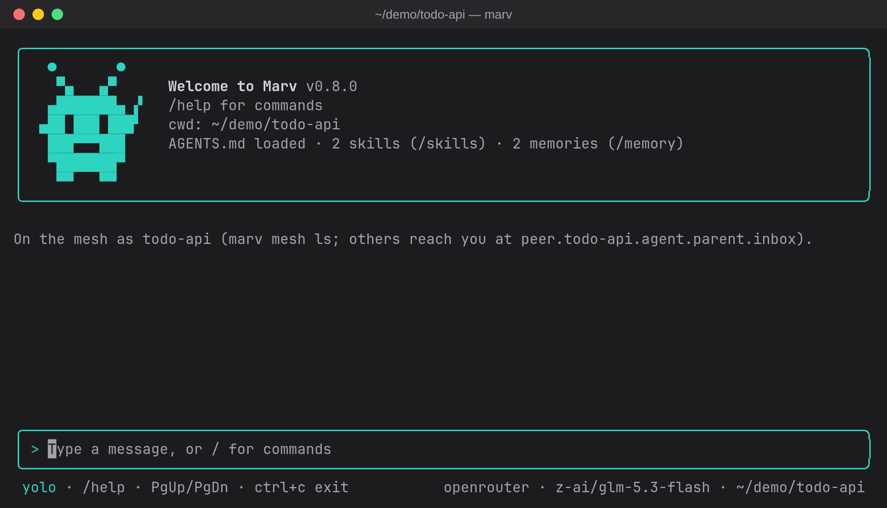
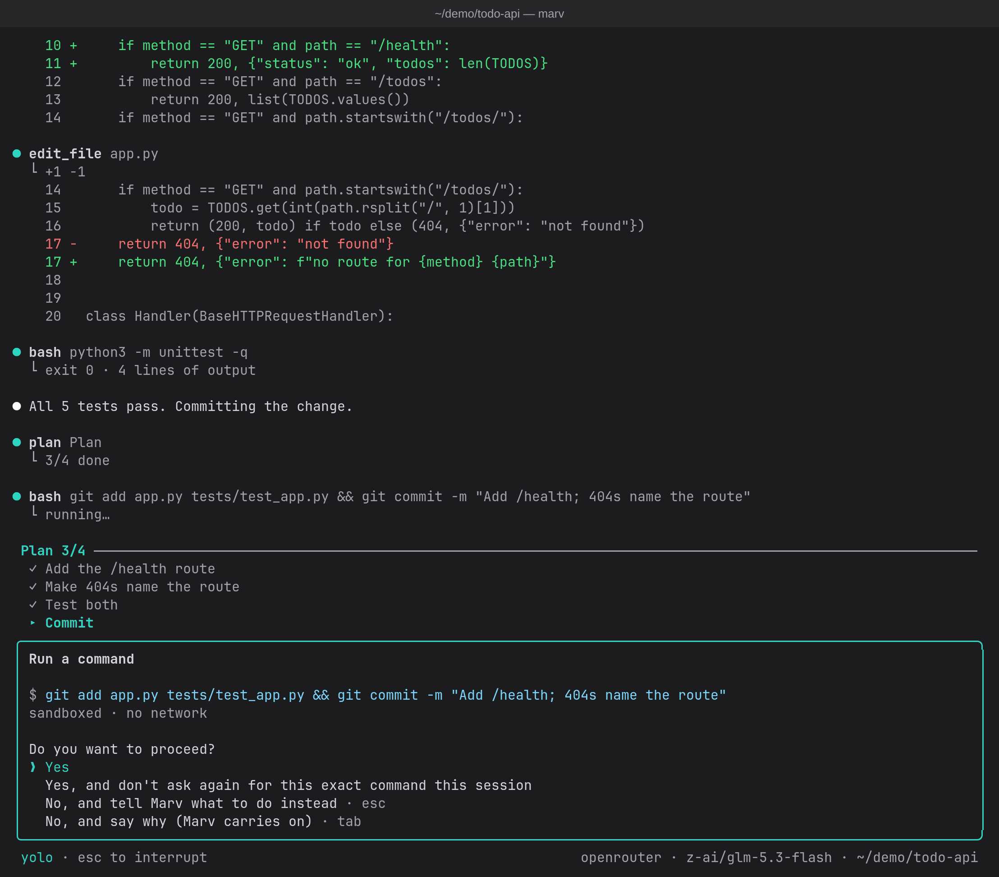

<p align="center"></p>

# Marv

A terminal coding agent. Marv reads your code, edits files and runs commands (sandboxed, and asking for your approval wherever the sandbox can't contain what it does), inside a full-screen terminal UI with a little martian for company.

Marv is written in Rust and ships as one static binary. Nothing else runs it: no Bun, no Node, no interpreter that could read a project's `.env` or `bunfig.toml` when it starts (npm is only one way to install it). It talks to models through [OpenRouter](https://openrouter.ai) (hundreds of cloud models with one API key), [Ollama](https://ollama.com) (models running on your own machine), or a plan you already pay for: ChatGPT Plus or Pro, Kimi Code or the Qwen Coding Plan, or a DeepSeek key ([below](#a-plan-you-already-pay-for)).



## Features

- **An agent loop with tools.** It can read, search (`glob`, `grep`), edit, write, and run shell commands. The model decides which tools to use; Marv runs them and reports back. Read-only calls in a row run in parallel.
- **Safe yolo mode (on by default).** Sandboxed commands and edits inside the project run without asking (sandboxed commands do so even with yolo off when `approveSandboxed` is set; by default it is, unless your config has `"yolo": false`; `/yolo off` turns it off, and `"approveSandboxed": "ask"` in your config does too); anything the sandbox can't contain (network access, git commits and other repository changes, `.git` itself, protected files like `.envrc` or `AGENTS.md`, memory) still shows you a colored diff or the exact command first: yes, yes for the rest of the session, no (which stops Marv so you can redirect it), or "no, and say why" (Tab), which skips that call and lets the turn carry on with your reason. `/yolo off` asks for every file change. `/permissions` shows everything Marv may currently do without asking.
- **Sandboxed commands.** Commands run in [bubblewrap](https://github.com/containers/bubblewrap): only the project folder is writable (plus a private `/tmp` that keeps its files from one command to the next in the same chat), your home folder (keys, SSH, Marv's own config) is hidden, there's no network unless a command asks for it, and API keys never reach the command. A retry of a command that failed for lack of network runs with the network, so it asks you like any network command.
- **Web pages.** `web_fetch` reads a page as text, asking per site. A page longer than one 30,000-character part is also saved whole on the first read, so the model can `grep` it or read just the part it needs instead of paging through it.
- **Guarded against prompt injection.** Once a web page, an MCP result or a message from another agent is in the conversation, anything that could send data out asks you, even in yolo and even after "don't ask again". Text from outside is shown to the model as data, never in Marv's voice. See [Safety model](#safety-model).
- **Dev servers you can open.** A command's processes end with it, and its `localhost` isn't yours, so Marv starts servers and watchers with its `process` tool instead: each keeps running in its own sandbox (same rules: only the project writable, no network unless asked) across turns until it's stopped or Marv exits, and the ports it listens on are forwarded to your `127.0.0.1`, so `http://localhost:5173` just works. You're asked before each start; `/processes` lists them, `/processes stop <name>` stops one, and the status bar shows how many run.
- **Any model.** OpenRouter or a local Ollama model, with a searchable model picker showing prices. Switch with `/model`. A ChatGPT, Kimi Code or Qwen Coding Plan subscription can pay instead, or a DeepSeek key ([below](#a-plan-you-already-pay-for)). Models that reason do so at medium effort by default, which saves tokens on coding work (`reasoningEffort` in the config).
- **MCP servers.** Connect any [Model Context Protocol](https://modelcontextprotocol.io) server, local or remote, in `~/.marv/mcp.json` or `.mcp.json` (Claude Code's format). Its tools join Marv's; calls ask first unless the server marks a tool read-only, since servers run outside the sandbox. With many tools connected, the model sees only their names and loads a tool's parameters when it needs one, so they don't cost thousands of tokens on every request. A project's servers only start once you trust them (`/mcp trust`). `/mcp add <npm package | URL | GitHub repo>` sets one up for you: it pins the version, shows you exactly what it will write, and starts it without a restart (see [Add an MCP server](#add-an-mcp-server)).
- **Skills.** Drop a `SKILL.md` into `.marv/skills/` (or `~/.marv/skills/`) and Marv loads it when a task matches, or run it yourself with `/<skill-name>`.
- **GitHub with your `gh` login.** If you use the GitHub CLI, Marv runs it for you, outside the sandbox: reading PRs, CI runs and issues just works, anything that changes GitHub asks first, and `gh auth` and friends never run. See [Connect GitHub](#connect-github).
- **Subagents.** Marv can hand a task to a fresh agent with its own context, which reports back when it's done, so the files it read don't fill up the conversation. Several can run in parallel, each in its own git worktree if they change files. Click one to watch its own transcript live. Agent types are Markdown files, compatible with Claude Code's.
- **The mesh.** Sandboxed agents can talk to each other, to other Marvs on your machine, to agents in [Herdr](https://herdr.dev) panes, and to Claude Code or opencode, over wires you approve. Nothing is wired by default. The opt-in [radio](#the-radio-who-else-is-up) shows your other Marvs above the prompt, passes short messages between them, and lets one ask another to do something (`/ask`) and report back. See [The mesh](#the-mesh-talking-to-other-agents).
- **Memory.** Marv remembers your preferences and project facts across sessions. Every change it makes to its memory needs your approval.
- **Sessions.** Every conversation is saved; `marv -c` continues the last one, `/resume` picks an earlier one.
- **Long conversations.** When the conversation passes 100k tokens, or 85% of the model's context window if that comes first, Marv summarizes it and carries on (`/compact` does it on demand; `compactTokens` in the config file sets the size). Requests reuse the provider's prompt cache wherever possible.
- **Trajectories and feedback.** Every turn is logged step by step (requests, replies, tool calls, subagents, timings, tokens) to `~/.marv/trajectories/`, with your ratings: `/good`, `/bad`, `/label`, and what your next message implies ("thanks, perfect" or "that's wrong").
- **Type errors caught early.** After Marv changes files in a TypeScript, Rust or Python project, it runs the project's own checker in the sandbox and tells the model about errors that weren't in the previous check, even in files it didn't touch, so it fixes broken callers before saying it's done. TypeScript: a `tsconfig.json` in the folder Marv starts in plus the project's own `typescript` or tsgo in that folder's `node_modules` (a global tsc isn't used). Rust: a `Cargo.toml` and a `Cargo.lock` there (the project is read-only to the check, so cargo can't write a lockfile; a crate inside a workspace is checked only when Marv starts in the workspace root, and `/diagnostics` says when Rust is skipped), checked with `cargo check --workspace --all-targets --offline` (errors only, tests included) using the cargo your shell would find; its build goes to Marv's check cache (`~/.cache/marv/checks`, `~/Library/Caches/marv/checks` on macOS; at most 20 GB, least recently used first), never the project's `target/`. The cache is filled once, in the background, at a session's first edit, so the first editing turn in a cold Rust project may get no checks; a session that never edits never builds the project. A check isn't capped in memory: a cold `cargo check` of a big workspace can take a few GB while it runs. Worktrees of one repository share the cache and take turns, so with several sessions editing one repository at once some steps skip the check. A proc macro or build script that prints to stdout makes cargo's output unreadable, and Rust checks stop for that session. Python: a `pyrightconfig.json`, `pyproject.toml`, `setup.py`, `setup.cfg` or `requirements.txt` there, checked with basedpyright or pyright `--outputjson` (errors only, the whole project): the project's own `.venv/bin/basedpyright` or `node_modules/.bin/pyright` first, else the `basedpyright` or `pyright` your shell would find; without one there are no Python checks (`pip install basedpyright` brings its own node). A uv venv's Python lives in `~/.local/share/uv/python`, which the sandbox hides, so in such a project Marv says once that it can't check. A step's notes list at most 40 errors across languages. `/diagnostics off` turns it off, `/diagnostics rust off` just Rust (or `python`), `/diagnostics clear` deletes this project's cache.
- **Your project's rules, as checks.** Rules from your instructions ("imports use `.ts` extensions", "never call X outside Y") can live in `.marv/checks/` as code: after a step that changed files, Marv runs the checks those files concern, in the sandbox, and tells the model only the violations its change added, with the reason. See [Checks](#checks).
- **A plan for long tasks.** For a task of four or more steps (or a request with several asks in one paragraph), the model writes a checklist with its `plan` tool and ticks it off as it works, updating it alongside its other tool calls rather than in requests of its own. Marv pins it above the prompt (`Plan 2/5`, the current item highlighted) until every item is done, saves it with the session, and hands it back to the model after the conversation is compacted.
- **Undo a turn.** Before a turn's first change Marv snapshots the project's files, and `/undo` shows what that turn changed (each file's diff) and, on a yes, puts those files back: edits, new files and deleted ones, whether a tool or a `bash` command made them. Your branch, index and stash are never touched. See [Undo](#undo).
- **No dead stops.** After 25 steps without finishing, Marv asks whether to keep going instead of giving up. Raise the interval with `/steps 40` (or `maxSteps` in the config), or turn the asking off with `/steps off` (subagents still stop at their own 50).
- **Cost tracking.** OpenRouter's actual charge per request, plus context and cache use, in the status bar; `/cost` for the breakdown, per model when the session used more than one (a `/model` switch, a subagent's own model).
- **Herdr aware.** Run Marv in a [Herdr](https://herdr.dev) pane and Herdr's sidebar shows whether it's working, waiting for your approval, or done, with nothing to set up. There the model also gets a `herdr` tool: it lists and reads panes without asking (what it reads counts as untrusted), asks before focusing or renaming a pane or typing a prompt into an idle agent's pane, and asks every time before running a command in a new pane or starting a worker (another Marv, or an agent such as Claude Code or Codex, optionally in its own git worktree). `/peers` lists the panes it opened.
- **A comfortable, light TUI.** Streaming Markdown replies revealed at an even pace, a live preview of the model's reasoning, mouse-wheel scrolling, drag-to-copy with auto-scroll, a `/` command menu, and Esc to interrupt. It uses next to no CPU while idle.

## Requirements

- Linux on x86_64 or aarch64, or macOS 14 (Sonoma) or newer on Apple silicon or Intel. **On Windows, use [WSL](https://learn.microsoft.com/windows/wsl/install)**: install Marv inside your WSL distribution (e.g. Ubuntu) and run `marv` there.
- On Linux, `bubblewrap` (`bwrap`) for the command sandbox (e.g. `sudo apt install bubblewrap`). Without it Marv still works, but every command asks first and warns that it runs unsandboxed, and what needs the sandbox is off: the typecheck, cargo check and pyright after edits, the project's checks and the `process` tool. On macOS the sandbox is Seatbelt (`/usr/bin/sandbox-exec`, built in), so there's nothing to install; the `process` tool isn't on macOS yet (#152).
- `git`, for `/undo` and for subagents' worktrees.
- One of:
  - an [OpenRouter API key](https://openrouter.ai/settings/keys),
  - a ChatGPT Plus or Pro plan (Continue with ChatGPT in setup), a Kimi Code or Qwen Coding Plan key, or a DeepSeek API key ([details](#a-plan-you-already-pay-for)), or
  - [Ollama](https://ollama.com) running locally, with a model that supports tool calling (e.g. `ollama pull qwen3.5:9b`).

## Install

```sh
npm install -g @flologixai/marv
```

npm installs the prebuilt binary for your machine (`@flologixai/marv-linux-x64`, `-linux-arm64`, `-darwin-arm64` or `-darwin-x64`, an optional dependency, so npm picks the one that fits; there's no postinstall script and no download at run time). The `marv` command it puts on your PATH is a small Node launcher that starts the binary. Installed 0.3.0 with `bun add -g`? Run `bun remove -g @flologixai/marv` first, so the old launcher doesn't shadow the new one.

Or, without npm, the installer from the GitHub release. It downloads the binary for your machine, checks its SHA-256 against the release's `SHA256SUMS`, and puts it at `~/.local/bin/marv`:

```sh
curl -fsSL https://github.com/Flologix/marv/releases/latest/download/install.sh | sh
```

Download `install.sh` to pass it options:

```sh
sh install.sh --prefix /opt/marv       # into /opt/marv/bin instead of ~/.local/bin
sh install.sh --version v0.14.1        # a given release instead of the latest
sh install.sh --from target/release/marv   # a binary you built yourself
sh install.sh --uninstall              # remove it again
```

Nothing is replaced until the new binary has been downloaded and checked, so a failed download changes nothing, and running it again is safe. It tells you if the folder isn't on your PATH.

Or from source (stable Rust 1.99 or newer):

```sh
git clone https://github.com/Flologix/marv.git
cd marv
cargo build --release -p marv-cli
sh install.sh --from target/release/marv     # or: cargo install --path crates/marv-cli --root ~/.local
```

Then start it in any project folder:

```sh
cd ~/some/project
marv
```

The first run opens a short setup: pick a provider (OpenRouter, a plan you pay for, or Ollama), pick a model, and paste your key (or sign in, for ChatGPT). Settings are saved to `~/.marv/config.json`, readable only by you. Run `/setup` to change them later.

### Updating

```sh
marv update            # update to the newest release
marv update --check    # only say whether there's one (exits 1 if there is)
```

`marv update` updates the way you installed: `npm install -g @flologixai/marv@<version>` for the npm package, or the release's `install.sh` (which checks the binary's SHA-256) into the same folder for an install.sh install. A build from source isn't touched: rebuild it. Marv never updates itself without you running this.

Once a day, `marv` (the TUI, never `marv -p`) asks npm's registry for the newest version in the background, and when there's a newer one it says so in one line: `✻ Marv 0.14.0 is out (you have 0.13.0): run marv update to update.` It's a plain request for a public version number, with no identifier or usage data, and it's cached in `~/.cache/marv/update-check.json` (`~/Library/Caches/marv` on macOS). Startup never waits for it, and when you're offline it says nothing. Only a version number from the answer is ever shown. To turn it off, set `"updateCheck": false` in `~/.marv/config.json`, or `MARV_NO_UPDATE_CHECK=1`. `NO_UPDATE_NOTIFIER` and `CI` turn it off too.

### A plan you already pay for

Marv can also run on a subscription, or another vendor's own key, instead of OpenRouter. Setup and `/setup` offer them all but Z.ai's (below); each key is saved in its own field, so switching providers never sends one vendor's key to another.

- **Sign in with ChatGPT.** Your ChatGPT Plus or Pro plan pays for Marv, through OpenAI's program for open-source agents: setup's **Continue with ChatGPT** opens your browser to sign in, and requests go to OpenAI's Responses API. The sign-in is saved to `~/.marv/chatgpt.json`, readable only by you; `/setup` can sign in again or sign out.
- **Z.ai GLM Coding Plan.** GLM-5.3 and GLM-5.3-Flash on the plan's own endpoint (`https://api.z.ai/api/coding/paas/v4`), with your plan's key from [z.ai/manage-apikey/apikey-list](https://z.ai/manage-apikey/apikey-list) (saved as `zaiApiKey`, or `ZAI_API_KEY`). **Not offered in setup yet:** Z.ai's [subscription terms](https://docs.z.ai/legal-agreement/subscription-terms) (§4.2) allow the plan only in [the tools Z.ai lists](https://docs.z.ai/devpack/tool/others), and Marv isn't one of them, so using it from Marv risks your plan. Marv will offer it once Z.ai lists it. A config that already names `"provider": "zai"` keeps working.
- **Kimi Code.** `kimi-for-coding` (K2.8), `k3` and `k3-256k` on your Kimi membership, through `https://api.kimi.com/coding/v1`, with a key from the Kimi Code console (saved as `kimiApiKey`, or `KIMI_API_KEY`). Overseas accounts can set `"baseUrl": "https://api.kimi.ai/coding/v1"`.
- **Qwen Coding Plan.** Qwen3.7-Plus, Qwen3.6-Plus and Qwen3.5-Plus on Alibaba Cloud Model Studio's Coding Plan (`https://coding-intl.dashscope.aliyuncs.com/v1`), with the plan's own key (`sk-sp-…`, saved as `qwenApiKey`, or `QWEN_API_KEY`). Mainland China's plan: `"baseUrl": "https://coding.dashscope.aliyuncs.com/v1"`. **Interactive use only:** Alibaba Cloud's [terms](https://www.alibabacloud.com/help/en/model-studio/coding-plan-faq) don't allow the plan's key in automated or non-interactive runs, and can suspend the plan. So `marv -p` refuses it. Don't let mesh messages wake a session on it either (`mesh.wake`): a woken turn runs with nobody typing.
- **DeepSeek.** `deepseek-flash` and `deepseek-v4-pro` on DeepSeek's own API (`https://api.deepseek.com`), pay as you go, with a key from [platform.deepseek.com/api_keys](https://platform.deepseek.com/api_keys) (saved as `deepseekApiKey`, or `DEEPSEEK_API_KEY`). Marv doesn't show DeepSeek's prices: they change with the time of day.

A build can offer Z.ai with `MARV_OFFER_ZAI_CODING_PLAN=1`, or leave ChatGPT out with `MARV_OFFER_CHATGPT_SIGN_IN=0`, set when it's compiled (`marv_provider::offered`). When a plan's usage limit is reached, Marv stops with a message saying so: it never switches to another key or provider by itself.

## Using Marv

Type what you want in plain language, for example:

```
> how does the config loading work?
> add a --verbose flag to the CLI and update the help text
> run the tests and fix whatever fails
```

Sandboxed reads, edits and test runs go ahead on their own; a commit, the network or a protected file waits for you:



### Commands

| Command | What it does |
|---|---|
| `/help` | Show available commands and shortcuts |
| `/model` | Pick a model (`/model <id>` to set one directly) |
| `/setup` | Change provider, model, or API key, or sign in to (or out of) ChatGPT |
| `/config` | Show the current configuration |
| `/think` | Let thinking models reason before answering (`/think on`, `/think off`) |
| `/skills` | List available skills; run one with `/<skill-name> <request>` |
| `/agents` | List the subagent types Marv can start |
| `/memory` | Show what Marv remembers |
| `/remember` | Save a note to memory (`/remember <note>`, or `/remember project: <note>`) |
| `/forget` | Remove a memory (`/forget <text from it>`) |
| `/resume` | Pick up an earlier session in this project |
| `/compact` | Summarize the conversation to free up context (`/compact <what to keep>`) |
| `/cost` | Tokens used and cost so far, per model when more than one served the session |
| `/sandbox` | Show or set the command sandbox (`/sandbox on`, `/sandbox off`) |
| `/yolo` | Run edits and sandboxed commands without asking (`/yolo on`, `/yolo off`) |
| `/permissions` | What Marv may do without asking: this session's "always" answers, pre-approved scopes, yolo, the sandbox and doors, and what's saved in your config |
| `/processes` | List the background processes Marv started (dev servers, watchers); `/processes stop <name>` stops one |
| `/good`, `/bad` | Rate the last turn, with an optional note (`/bad edited the wrong file`) |
| `/label` | Tag the last turn (`/label refactor, tests`) |
| `/mcp` | Show MCP servers and their tools; `/mcp add <package \| URL \| repo>` adds one, `/mcp search <words>` finds one, `/mcp remove <name>` takes yours out, `/mcp trust` starts the project's, `/mcp login <name>` logs in to a remote server (OAuth), `/mcp logout <name>` forgets the login |
| `/undo` | Show what the last turn changed and, on a yes, put those files back; again for the turn before ([Undo](#undo)) |
| `/checkpoints` | Show or set the snapshots `/undo` needs (`/checkpoints on`, `/checkpoints off`) |
| `/diagnostics` | Show or set the checkers after edits, tsc, cargo check and pyright (`/diagnostics on`, `/diagnostics off`, one language: `/diagnostics rust off`; `/diagnostics clear` deletes this project's check cache) |
| `/checks` | List the project's checks and their last result (`/checks on`, `/checks off`) |
| `/steps` | Show or set the step limit (`/steps 40`, `/steps off` never asks) |
| `/trajectories` | Show or set run logging (`/trajectories on`, `/trajectories off`) |
| `/radio` | Who of your Marvs on this machine is up, and what was said, on the mesh radio (`/radio on`, `/radio off`; [The radio](#the-radio-who-else-is-up)) |
| `/tx` | Say something on the radio: `/tx @name text` to one Marv (`@a @b` for several), `/tx text` to all of them |
| `/ask` | Ask one Marv on the radio to do something: `/ask @name text`; it acknowledges, then reports `done` or `failed` |
| `/mesh` | What's wired to this Marv's inbox; `/mesh wake on` lets a message start a turn while Marv is idle ([The mesh](#the-mesh-talking-to-other-agents)) |
| `/peers` | In Herdr: the panes and workers the model opened (`/peers read <name>`, `/peers stop <name>`) |
| `/clear` | Start a fresh conversation (the old one stays saved) |
| `/exit` | Quit |

Type `/` to open the command menu: ↑/↓ to choose, Enter to run, Tab or → to complete. Or press ctrl+k for the command palette: it opens over what you've typed (Esc brings it back) and while a reply streams, searches commands, skills, settings and keys by name and description, and shows each setting's current value (`Yolo: off`, `Model: …`): Enter on a toggle flips it as its command would.

### Keys

| Key | Action |
|---|---|
| Esc | Stop a reply or a running tool (in a subagent's view: go back) |
| Enter (while Marv works) | Queue your message: it's listed above the prompt and sent as the next turn when this one finishes. Esc keeps the queue (Enter on an empty prompt then sends the next) |
| alt+enter or ctrl+s (while Marv works) | Send now: your message goes in at Marv's next step (after the current reply and tool calls), instead of after the turn. Nothing running is stopped |
| ↑ / ctrl+x (empty input, messages queued) | Take the newest queued message back to edit / drop it |
| ctrl+c | Stop / clear the input / press twice to quit |
| ctrl+k | Command palette: search commands, skills, settings (with their values) and keys; Enter flips a toggle |
| ctrl+o | Show or hide details: what subagents did, and whole diffs |
| Click a subagent | Open its own transcript, live |
| PgUp / PgDn, mouse wheel | Scroll the conversation |
| Drag with the mouse | Select text; it's copied when you let go (drag past the edge to scroll) |
| ↑ / ↓ | Previous inputs |
| Tab or → (empty input) | Take the suggested next message shown in the prompt; Enter then sends it |
| Tab (at an approval) | Decline and type a short reason; Enter sends it and Marv carries on without that call |

### Command-line options

```
marv                 start an interactive session
marv -c              continue the latest session in this folder (--continue)
marv -r              pick an earlier session to resume (--resume)
marv -m <model>      use a different model (--model)
marv -p <prompt>     run one turn without the UI (see "Using Marv from scripts")
marv mesh ls         list the Marvs on this machine you can wire to (see "The mesh")
marv mesh wire …     ask for a wire between agents
marv mesh plug …     plug another agent into a Marv over stdin/stdout
marv update          update to the newest release (--check: only say whether there is one)
marv --version       print the version (-v)
marv --help          show the help
```

## Safety model

Marv is built so that you stay in control of what changes on your machine:

1. **Reading is free; what can't be contained needs approval.** Reading and searching files never asks. With yolo mode on (the default), commands that run in a working sandbox without network, and edits inside the project (but not in `.git` or a protected file), run without asking; everything else shows you exactly what will happen first: a command that wants the network or changes the git repository (it must say so with `git_write`), an edit to a protected file, any command when the sandbox is off or unavailable, and every memory change. With `/yolo off`, every edit asks, and so does every command unless `approveSandboxed` is `"auto"` in your config (by default a sandboxed command without network runs without asking in your turns, yolo or not, unless your config sets `"yolo": false`; `/yolo off` and `"approveSandboxed": "ask"` turn it off). In a turn a mesh message woke, such a command runs without asking with the project read-only: it can inspect and build into `/tmp`, and anything that has to change the project asks. "Don't ask again" covers the rest of the session only: all file edits, or one exact command. "No" (or Esc) stops the turn so you can say what to do instead; "No, and say why" (Tab at the prompt) takes a short reason instead: the call isn't run, the model reads your reason as the call's result, and the turn carries on.
2. **Protected files always ask.** Some files run code or instructions outside the sandbox later: `.git/` (any level) and the `core.hooksPath` folder (git runs hooks and config from them on your next commit), `.env*` and `.envrc` (your shell's loaders read them), `bunfig.toml`, `.mcp.json`, `AGENTS.md` and `CLAUDE.md` at any level, `.marv/`, `.vscode/` and `.idea/`, and the lifecycle `scripts` in `package.json`. A change to one asks every time, in yolo too, and "don't ask again" never covers it. Inside the sandbox they're read-only, and one a command creates is found and taken back. Paths are checked after following symlinks, so a link named `innocent.sh` pointing at `.envrc` counts as `.envrc`. What this can't protect: other files you later run yourself, like a script or a `Makefile`; review with `git diff` before running them.
3. **Paths are confined to the project.** Tools refuse anything outside the folder Marv was started in, including through symlinks (dangling ones too). Skills' files are checked the same way.
4. **Commands run in a sandbox.** The system is read-only, `/run` (where your desktop's sockets live) is empty, and the home folder is a stand-in: toolchains like `~/.bun`, `~/.cargo`, `~/.local/share/mise` and your git config are mounted read-only, with credential files inside them masked. The project folder is the only writable place, and there's no network unless the command asks for it, which the approval prompt shows. The environment starts empty, so API keys can't leak into commands. Started in your home folder itself, Marv works there too, but the sandbox shows the home read-only and hides its hidden folders (Marv's config, credentials, `~/.config`, `~/.local`, agent sockets) and any socket in it: commands write only to `/tmp`, and file changes go through Marv's edit tools, which ask you each time there ("don't ask again" isn't offered for them).
5. **Outside text is data, and it taints the session.** What a web page, an MCP server or another agent sends is fenced as data for the model, never in Marv's voice; so are project checks' and the typecheck's messages. Once any of it is in the conversation, every call that could send something out asks, in yolo too and whatever "don't ask again" you gave: a command with network, every MCP call (read-only ones too), a web page under a new address prefix, a message on a wire not yet approved. Subagents start tainted when their parent is, and never inherit its network, web or mesh approvals.
6. **Nothing in the project configures Marv.** Marv's settings come from `~/.marv/` (or `MARV_CONFIG_DIR` from your real environment), never from a file in the project. No runtime starts with Marv, so nothing reads the project's `.env`, `bunfig.toml` or `node_modules` along the way. Text from the model never reaches your terminal raw: escape codes, control characters and bidi overrides are stripped first, in `marv -p`'s output too.
7. **Memory changes are approved too.** Memory comes back in every future session, so an instruction planted by a malicious file and saved there would be a persistent prompt injection. You see every memory before it's saved.
8. **MCP servers are trusted explicitly, and their calls ask.** A server is a program running with your permissions, outside the sandbox, so a project's `.mcp.json` servers start only once trusted, for that exact config and the project files its command runs (if either changes, it needs trusting again). Every call asks unless the server marks the tool read-only. Yolo mode never skips these. Local servers get no API keys from Marv's environment, only what their config gives them. Your own servers start in your home folder, not the project (so a package planted in the project can't stand in for one); use `${MARV_PROJECT_DIR}` in their arguments if they need the project path. A server's `instructions` are ignored.
9. **Background processes ask first, and stay as contained as commands.** A server or watcher the `process` tool starts asks every time a new command starts (yolo too; "don't ask again" covers that exact command for the session). It runs in its own sandbox like a command: the project is the only writable place, `.git` is read-only, the home folder is hidden, and there's no network unless the start asked for it. Only the ports it listens on (1024 and up, at most 4) are forwarded, to your `127.0.0.1` only, never another interface; nothing on your machine is reachable from it. It stops on `/processes stop`, when Marv exits, and with Marv even if Marv is killed. Subagents can't start one.
10. **One command outside the sandbox, only if you say so each time.** For what can't work in the sandbox (a system service, a tool under your hidden home folder), the model can ask to run one `bash` command on your machine, as you, with `sandbox: false`. The prompt says so in a warning line, it asks every time (yolo too, never "don't ask again"), and the command gets your environment minus Marv's keys and anything that looks like a secret. Only the TUI offers this: `marv -p` and subagents are refused before anything is asked.
11. **Subagents ask like Marv does, or work in a worktree.** A subagent in the project folder asks before each change, and the prompt says which one is asking. One in its own git worktree is approved once when it starts; inside its sandboxed worktree its edits and commands then run without asking, except commands that want the network (and with the sandbox off, everything asks). It can't touch the repository's `.git` (it's read-only in the sandbox, so no commits, branch moves, hooks or config), and when it's done, Marv commits its changes to its branch, without running any of the repository's hooks. Its work comes back as a branch you (or Marv, with your approval) review and merge. Esc at an approval prompt declines everything waiting and stops the run.

[`docs/SECURITY.md`](docs/SECURITY.md) has the full list of rules; each one has a test in `tests/guards/` that fails when its guard is removed.

## Skills

A skill is a folder with a `SKILL.md`:

```markdown
---
name: release-notes
description: How to write release notes for this project. Use when asked for release notes or a changelog.
---

1. Run `git log` since the last tag…
2. Group the changes into Added / Changed / Fixed…
```

Put it in `.marv/skills/<name>/` (this project) or `~/.marv/skills/<name>/` (all projects). Only each skill's name and description go into the system prompt; Marv loads the full instructions when a request matches. A skill folder can also hold scripts and reference files. Write descriptions that name the task and when to use it: that's how the model decides.

## MCP servers

Servers go in `~/.marv/mcp.json` (yours, every project) or the project's `.mcp.json`, in Claude Code's format:

```json
{ "mcpServers": {
  "filesystem": { "command": "npx", "args": ["-y", "@modelcontextprotocol/server-filesystem", "${MARV_PROJECT_DIR}"] },
  "example": { "type": "http", "url": "https://mcp.example.com/mcp", "headers": { "Authorization": "Bearer ${EXAMPLE_TOKEN}" } }
} }
```

- `${VAR}` and `${VAR:-default}` read your environment, so tokens stay out of the file. `/mcp` shows each server as written, with the variables it reads, never their values.
- Local servers (stdio) and remote ones (Streamable HTTP) both work. An optional `timeout` sets the seconds per call (default 120). The old `sse` transport isn't supported.
- Servers start in the background when Marv does, and the first request waits for them. Restart Marv after editing a config by hand (`/mcp add` starts its server at once).
- A project server can't take the name of one of yours, and starts only once you trust it with `/mcp trust` (see [Safety model](#safety-model)). Once the servers have started, an "MCP" notice lists those that failed, those waiting for trust (what each runs and reads from your environment) and those that need a login. Trust given by Marv 0.3.0 doesn't carry over (the trust key changed).
- With many tools connected (specs that would cost more than 8,000 tokens per request, or 10% of the context window if that is less), the model gets their names and two tools to look one up and call it. `"mcpTools": "eager"` in `~/.marv/config.json` sends every spec with every request instead, `"deferred"` always sends names only.

### Add an MCP server

`/mcp add` works out a server's entry, shows it to you once, writes it to `~/.marv/mcp.json` (yours, every project) and starts it in the running session:

```sh
/mcp add @modelcontextprotocol/server-filesystem -- ${MARV_PROJECT_DIR}     # an npm package (npm: prefix optional)
/mcp add pypi:mcp-server-fetch                                              # a PyPI package (run with uvx)
/mcp add https://mcp.example.com/mcp --header "Authorization: Bearer ${EXAMPLE_TOKEN}"   # a remote server
/mcp add io.github.acme/weather                                             # a name from the official MCP Registry
/mcp add https://github.com/acme/weather-mcp                                # a repo whose README names a package or URL
/mcp search weather                                                         # look in the MCP Registry
/mcp remove weather                                                         # take one of yours out again
```

- **Pinned.** A package is written as `npx -y <pkg>@<exact version>` or `uvx <pkg>@<exact version>`, resolved before you're asked (`name@1.2.3` asks for a version; it must exist). npm and PyPI never let a published version's files change.
- **One approval, of exactly what's written.** The prompt shows the command line, the version and when it was published and by whom, the repository the package names (npm and PyPI don't check that field), the registry publisher's verified namespace, every environment variable the server reads (and whether it's set), and the JSON it writes. Warnings stand out: a deprecated or yanked version, a package first published in the last week, a GitHub README naming a package whose own repository is a different one. Yes writes that JSON as shown; nothing fetched afterwards changes it. There's no "don't ask again": each server is its own decision.
- **Secrets stay in your environment.** `--env NAME` writes `"NAME": "${NAME}"`, and `--header` takes `"Name: Bearer ${VAR}"`; a value typed in (`--env KEY=sk-…`, a literal header) is refused, since the file sits on disk. A variable that isn't set means the entry is written but not started: set it in your shell and restart Marv.
- **Options:** `--name <name>` (by default it comes from the package, `@modelcontextprotocol/server-filesystem` → `filesystem`, or the URL's host), and arguments for the server after `--`. A registry entry's fixed arguments and required variables are filled in; a required argument with no value goes after `--`.
- **GitHub repos:** Marv reads the README (with `GITHUB_TOKEN` or `GH_TOKEN` if set) and takes only a package name or an https URL from its config examples, nothing else from the block (no extra arguments, no `env` values; the variable names it uses are suggested as `--env`). Several candidates: you get the `/mcp add` commands to choose from.
- **Its tools** reach the model from your next message. `/mcp remove <name>` takes one of your servers out and stops it; its tools stay listed (failing) until `/clear` or a restart. A project's servers stay in `.mcp.json`, edited by hand.

Known limits: npx resolves a package's own dependencies by their version ranges when it first runs (there's no lockfile to pin them); a remote server is whatever its owner deploys at that URL; no Docker images and no building from source yet (a README that only shows those is reported, not followed); a PyPI package whose command has another name than the package needs a hand edit.

### Servers that need a login

A remote server that wants an OAuth login, rather than a token in `headers`, shows as `needs login` at startup and in `/mcp`. Log in with:

```sh
/mcp login linear      # opens your browser; when it comes back, Marv stores the tokens and connects
/mcp logout linear     # forgets the login, and revokes it where the server allows
```

- **Only you start a login.** Startup, a tool call and the model never open a browser or register Marv with a server; a server whose login runs out (its refresh token refused) says `needs login` again, and its tools fail with a message telling the model to ask you.
- **The browser comes back to Marv** on `127.0.0.1` (a random port, PKCE, a random `state`). Over SSH or without a display Marv doesn't open a browser: it shows the link. Open it anywhere; if the browser then shows an error page (it couldn't reach `127.0.0.1` on that machine), paste the address it ended up on into Marv's prompt. That address goes to the login, never to the model, and the transcript shows `(login callback)`. A login gives up after 5 minutes; `/mcp login` again starts over.
- **Tokens** are kept in `~/.marv/mcp-tokens.json` (0600), per server URL: your servers share one login across projects (renaming a server keeps it), and a project's server (from `.mcp.json`, trusted first) gets its own. Marv renews the access token with the refresh token when it runs out, also in `marv -p` using the same config folder; `marv -p` never starts a login, and says which server needs one. Tokens never reach the model, the transcript, session files, trajectories or sandboxed commands.
- **Servers without dynamic registration** need a client you register yourself (an OAuth app at the provider, with the redirect URI `http://127.0.0.1:<port>/callback`), in the server's entry:

```json
{ "mcpServers": { "example": {
  "type": "http", "url": "https://mcp.example.com/mcp",
  "oauth": { "clientId": "abc123", "clientSecret": "${EXAMPLE_CLIENT_SECRET}", "callbackPort": 33418, "scope": "read write" }
} } }
```

  All of `oauth` is optional: `clientId` and `clientSecret` (a `${VAR}`, like headers; leave it out for a public client), `callbackPort` (the port of the redirect URI you registered), and `scope` (space-separated: the scope Marv asks for, instead of the one the server suggests). `/mcp` shows the client id and scope, never the secret. A server with its own `Authorization` header logs in with that, not with `/mcp login`.

Known limits of logins: no login from `marv -p` (log in once in the TUI); a client registered by hand needs its exact `callbackPort` free when you log in.

## Connect GitHub

**If you use `gh`, there's nothing to do.** When the [GitHub CLI](https://cli.github.com/) is installed and logged in (`gh auth status`), Marv offers the model a `github` tool that runs `gh` for it, outside the sandbox, with your own login. Ask "check the current project" and it reads the open PRs, the failing CI run and the issues without a prompt. The rules:

- **Reads run at once:** `pr list|view|checks|diff|status`, `issue list|view|status`, `run list|view` (`--log-failed` too), `workflow list|view`, `repo view`, `release list|view`, `label list`, `search …`, `status`, and `gh api` GET requests.
- **Changes ask first**, since other people see them: commenting, creating, editing, closing, reopening, merging or reviewing PRs and issues, releases, re-running or cancelling runs, `workflow run`, `label create`, and `gh api` with fields, another method or `graphql`. A merge or close names the repository. "Don't ask again" works per command (`gh pr comment`). `gh api` reads of secrets, variables, keys, webhooks, installations, invitations and your emails ask every time.
- **Never run:** `gh auth`, `config`, `extension`, aliases (any unknown command), `secret`, `variable`, `ssh-key`, `gpg-key`, `codespace`, `gist`, `--web`, downloads, `gh api --input` and `--verbose`, and `pr checkout`/`repo clone` (they'd run git outside the sandbox, with hooks a command may have written; the model checks out a PR with an approved `git fetch` instead). Nothing reaches a GitHub host the project doesn't name: `-R`, `--hostname` and URLs must point at the host of the project's `origin` (`github.com` outside a repository), which is all GitHub Enterprise needs.
- `gh` gets your environment minus Marv's own keys and anything secret-looking (its own `GH_TOKEN`/`GITHUB_TOKEN` kept), never prompts, and is spawned without a shell. Tokens in its output (`ghp_…`, `github_pat_…`) are replaced with `[redacted token]` before the model, the transcript or a log sees them.
- Subagents can read with it, not write. In `marv -p`, reads run and changes need `--approve github`.
- `MARV_GITHUB=off` hides the tool (to use the MCP server below instead). Marv checks for `gh` once at startup, so log in before you start it.

`gh` typed into a bash command still fails, on purpose: the sandbox has no network, hides `~/.config/gh` and starts with an empty environment, so a token can't be printed into output that goes to the model provider. Don't "fix" that by mounting gh's config into the sandbox; the `github` tool is the way.

**Without `gh`**, or for a fine-grained token limited to a few repositories, connect GitHub's official MCP server ([github/github-mcp-server](https://github.com/github/github-mcp-server)). It runs outside the sandbox with its own token, so the model never sees the token, read-only tools run without asking, and anything that changes something (a comment, a merge, a push) shows you an approval prompt first. (A `web_fetch` of a public GitHub page works without any setup; it just can't authenticate or act.)

1. Create a **fine-grained** personal access token ([github.com/settings/personal-access-tokens/new](https://github.com/settings/personal-access-tokens/new)): "Public repositories" or selected repositories only, with repository permissions `contents: read`, `issues: read`, `pull requests: read`, and `metadata: read` (selected automatically). Add the write permissions you want Marv to be able to use, e.g. `issues: write` and `pull requests: write`; every write still asks you first. Don't reuse the token the `gh` CLI uses: a fine-grained token on a few repos limits the blast radius if something goes wrong.
2. Export it as `MARV_GITHUB_TOKEN` in your shell (e.g. in `~/.profile`), so it never lands in a file.
3. Write the server to `~/.marv/mcp.json`:

```json
{ "mcpServers": { "github": {
  "command": "docker",
  "args": ["run", "-i", "--rm", "-e", "GITHUB_PERSONAL_ACCESS_TOKEN", "-e", "GITHUB_TOOLSETS", "ghcr.io/github/github-mcp-server"],
  "env": { "GITHUB_PERSONAL_ACCESS_TOKEN": "${MARV_GITHUB_TOKEN}", "GITHUB_TOOLSETS": "default" }
} } }
```

   Needs [Docker](https://docs.docker.com/get-started/get-docker/); without it, [build the server from source](https://github.com/github/github-mcp-server?tab=readme-ov-file#build-from-source) and point `command`/`args` at the binary (`["<path>", "stdio"]`). `GITHUB_TOOLSETS` picks the tool groups (`default` is `context`, `repos`, `issues`, `pull_requests`, `users`; add `,actions` for CI). To run it strictly read-only, add `"GITHUB_READ_ONLY": "1"` to `env` (and `-e GITHUB_READ_ONLY` to `args`): then merging or commenting is impossible rather than merely approved.

4. Restart Marv and check `/mcp`: the server should be listed with its tools. Try "list the open PRs in owner/repo" (no prompt: read-only), then "comment on PR 7" (asks first).

## Agents

An agent type is a Markdown file, in the same format as Claude Code's agent files:

```markdown
---
name: code-reviewer
description: Reviews a change for bugs and missing tests. Use after implementing a task, before merging it.
tools: read_file, grep, glob, bash   # optional; Claude Code names (Read, Grep, Edit…) work too
model: inherit                       # optional; or a model id on the same provider
---

You are a careful code reviewer. Read the diff, then the code around it…
```

Put it in `.marv/agents/<name>.md` (this project) or `~/.marv/agents/<name>.md` (all projects); there are also two built-in agents: `general-purpose`, with every tool, and `explore`, which can only read and search (`read_file`, `grep`, `glob`, `web_fetch`; no edits, no `bash`, no mesh tools, even in yolo) and is the one Marv uses for searches. A file with the same name replaces a built-in one, so `.marv/agents/explore.md` with `model: <a cheaper model>` runs searches on that model (built-ins use the session's model). Keep such a replacement read-only: the agent tool tells the model that `explore` only reads and searches, whatever the file gives it. A subagent starts with a fresh conversation that holds only the task it was given, and never gets the `agent`, `memory` or `plan` tools. Only names and descriptions go into the system prompt, so write descriptions that say when to use the agent. A reference like `superpowers:code-reviewer` finds `code-reviewer`, so skills written for Claude Code work unchanged. `/agents` lists what loaded, and why any file didn't.

## Checks

A check is one rule of your project, in `.marv/checks/`, one file per rule. A simple rule is declarative (YAML or JSON):

```yaml
# .marv/checks/imports.yaml
glob: ["src/**/*.{ts,tsx}"]      # the files it reads; it runs after a step that changed one of them
exclude: src/generated/**        # optional
forbid: 'from\s+["''](\.{1,2}/[^"'']*?)(?<!\.tsx?)["'']'   # or require: a pattern each file must contain
flags: m                         # optional: i, m, s, u
message: relative import without its .ts extension
why: Bun runs the sources as they are, so an import without its extension fails at run time.
```

A rule that needs code is a script, `.marv/checks/<name>.ts`, run with the project's `bun` (it must be on the PATH the sandbox sees) from the project's root. Its first comments say which changes concern it (`// glob: src/**/*.ts`; without one it runs after any change), and it prints one JSON line per violation, `{"file": "src/a.ts", "line": 3, "message": "…", "why": "…"}`, then exits 0 (any other exit is reported as the check failing).

After a step that changed files, Marv runs the checks whose glob matches one of them and tells the model only what's new since the turn began (matched by check, file and message, not line), with each check's `why`. Checks are code from the repository, so like the typecheck they run only in the sandbox, with the project read-only and no network, never ask for approval, and don't run at all without the sandbox. `/checks` lists them, what couldn't be loaded, and the last result; `/checks off` (config `checks`) turns them off.

## Undo

Every turn that changes files gets two snapshots: one just before its first change (any `edit_file`, `write_file` or `bash` command, a subagent's in the shared folder too) and one when the turn ends, however it ends. They're git commits written through a temporary index, so your index, `HEAD`, branches and stash stay exactly as they were. In a repository they're kept under a hidden ref, `refs/marv/checkpoints/<session>`, which `git branch`, `git status`, `git push` and `git fetch` don't show (`git log --all` and `git push --mirror` do); outside a repository, in a git folder of Marv's own under `~/.marv/checkpoints/` (up to 20,000 files and 200 MB of new content; past that, checkpoints are off for that project for the session).

`/undo` takes the newest turn not yet undone and shows each file it changed with its diff: restored, deleted (the turn created it) or recreated (the turn deleted it). Files you edited since the turn ended are marked; they're restored too. Nothing is written before you say yes. Before writing, Marv takes one more snapshot, so an undo can itself be undone by hand (`git checkout <sha> -- file`, the sha from `git log refs/marv/checkpoints/<session>`). `/undo` again goes one more turn back. The conversation isn't rewound: the model is told what was undone at the start of your next message.

What `/undo` can't put back: files git ignores (`.env`, `node_modules/`, build output; they're listed as "not restored"), anything outside the project folder, and anything a command did outside files (a database, a server, a push). Changes you make yourself while a turn runs count as that turn's. A repository's clean filters (git-lfs) run when Marv snapshots, as they do on your `git status`. At a session's first turn, refs older than 14 days beyond the 20 newest sessions are deleted; git's own gc collects their objects later. `/checkpoints off` (config `checkpoints`) turns it all off.

## The mesh: talking to other agents

Marv's agents are sandboxed: no network, and every process ends with its command. So two agents can't talk to each other, or to your other tools, unless you wire them. The mesh is how: each Marv runs a **switchboard** outside every sandbox, agents reach it through a **plug** (a Unix socket mounted into their sandbox, so it works with no network), and services they can reach are **receptacles**, such as another agent's inbox. Nothing is live until it's wired.

- **Nothing is wired by default.** A wire is a grant from one plug to one receptacle, in one mode (`send` into an inbox, or `call` for an answer). The first time an agent uses a receptacle, Marv asks you to approve the wire. Yolo never wires anything, and an agent can't wire itself.
- **Mesh text is data.** A message reaches the model fenced as a message from another agent, not as instructions, and it taints the session (see [Safety model](#safety-model)). Every message is logged to the trajectory (sender, receptacle, size; never the body), and each wire has size and rate limits.
- **Subagents** get a plug with no wires. The model has three tools: `mesh_list` (what this agent can reach), `mesh_send` and `mesh_call`.

**Several Marvs on one machine.** Every interactive Marv is on the mesh (when it has a runtime folder: `$XDG_RUNTIME_DIR/marv`, or `MARV_RUNTIME_DIR`), and says its name at startup: `MARV_MESH_NAME` if you set it, else the project folder's name plus four hex digits. Its door is a socket in the runtime folder's `mesh/`, private to you.

```sh
MARV_MESH_NAME=api marv          # in one pane
MARV_MESH_NAME=web marv          # in another
marv mesh ls                     # in a third: the live Marvs, and in Herdr the agent panes they can reach
marv mesh wire 'api -> web:inbox'
```

`marv mesh wire` asks; it doesn't approve. A wire to another Marv is approved on **both** ends: `api` asks you first, then `web` does. After that, tell `api` "tell peer.web.agent.parent.inbox that the API is ready", and `web` reads it at its next turn, as a message from `peer-api`. (Or skip `marv mesh wire` and just ask: the same two approvals come up when the agent first sends.)

**Herdr panes.** In a [Herdr](https://herdr.dev) pane, a Marv also offers each Herdr agent pane as two receptacles: `herdr.pane.<pane>.status` (call: the pane's agent and its state) and `herdr.pane.<pane>.send` (types a prompt into that pane, only while its agent is idle or done, so it can never answer an approval there). `marv mesh ls` prints their names. Each pane is its own wire, so approving one approves typing into that pane only.

**Claude Code, opencode and other MCP clients.** `marv mesh plug <marv> [--as <name>]` is a stdio MCP server: add it to the other agent's MCP config (command `marv`, args `["mesh", "plug", "web", "--as", "claude"]`), then wire it like any agent: `marv mesh wire 'web/claude -> web:inbox'`, approved in `web`. Its receptacles show up as MCP tools (`agent_parent_inbox`); restart the MCP server after wiring so the client lists the new tool.

**In `marv -p`** the mesh is off unless you ask for it: `--approve mesh:<receptacle>` pre-approves wires to that receptacle (and nothing else), and `MARV_MESH_NAME` puts the run on the mesh under that name. A message from another agent taints the session, so a send after one also needs `--approve-tainted`.

Not yet: `watch` (subscribing to events), unwiring across processes (a wire to another Marv lasts until that Marv ends), a tmux adapter, and wires across machines. [`docs/MESH.md`](docs/MESH.md) has the design.

### The radio: who else is up

The radio is a live channel between your Marvs on this machine. It's **off unless you turn it on**: `/radio on` (or `"mesh": {"radio": true}` in your own `~/.marv/config.json`). Each Marv with it on then shows the others in one line above the prompt:

```
 ◉ radio · 58a7 working "fix the login test" · docs-11c2 idle · api-3f9a waiting · +1
```

- **What's shared (presence):** the Marv's mesh name, whether it's idle, working or waiting for its user, the conversation's title (your first message, one line, at most 56 characters), the project folder's name (not its path), its Herdr pane, whether its wake is on, and Marv's version. Nothing else: no model, cost, file paths, transcript or config. `"mesh": {"radio": {"titles": false}}` leaves the title out (`/radio off` keeps that choice, as `{"on": false, "titles": false}`).
- **Presence reaches no model.** It's only drawn in the strip and in `/radio` (the roster with full names, panes and how long each state has lasted, then the last messages; Esc closes it). The model learns only names and states, from `mesh_list`'s "On the radio" section, and that doesn't taint the conversation.
- **Short messages.** `/tx @58a7 tests pass on main now` sends one Marv a message (`@a @b` for several; the short name works when it's unique), `/tx tests pass on main now` sends it to all of them. Your transcript gets one line (`✻ Radio → @58a7: tests pass on main now`) and your own model nothing. The model has `radio_tx` for the same, in a conversation that started with the radio on (turning it on mid-conversation brings it with the next one, `/clear`; turning it off leaves the tool there, saying the radio is off). A message is at most 2 KB (longer is refused, never cut), 20 a minute per sender in bursts of 5.
- **What arrives is data.** A message flashes on the strip for 10 seconds (`◉ radio · ← 58a7: tests pass on main now`) and reaches your model at its next step, fenced as another Marv's words, never as yours: the conversation counts as tainted from then on, so anything that can send data out (network commands, web, MCP, mesh) asks first, even in yolo. A message marked `(user)` was typed by the other Marv's person; it's shown, and changes nothing. Nothing on the radio can answer an approval.
- **Wake.** With mesh wake on (`/mesh wake on`) and Marv idle with no approval waiting, a message addressed to it starts a turn (`✻ Radio message from 58a7 (model).`); a message to all never does. In that turn **nothing is approved automatically**: yolo, "always" answers and pre-approved scopes don't apply, and everything that would ask asks you, once. At most 3 radio wakes a minute per sender (one every 10 s) and 10 in 10 minutes overall; past that, messages wait for your next turn and you're told once.
- **Requests.** `/ask @58a7 run the e2e suite and tell me what fails` asks one Marv to do something (the model does the same with `radio_tx`, `kind: "request"`). It acknowledges at once (`on it`, `queued: busy`, or `queued: waiting for 58a7's user`), works on it in its next turn (one the request starts, with wake on, or its person's next turn), and when that turn ends reports back on its own, with no extra model call: `done` with the first paragraph of its final reply, or `failed` with why (stopped, declined, ended early, or it left). The report shows in your transcript (`✻ Radio ← 58a7 done r17: …`) and reaches your model as another Marv's data. **A turn that handles a request approves nothing automatically**, yolo or not: every action asks that Marv's person. A Marv asking a Marv that asks back can't ask a third time (two hops), at most 2 of your requests wait at one Marv, and a report wakes you only for a request your own turn sent. Typing into the Herdr pane of a Marv that's on the radio is refused: ask it on the radio instead.
- **Who's gone.** A Marv that leaves (`/radio off`, or quitting) shows `left` for 10 seconds. One that stops answering shows `silent` after 45 seconds and drops after 120; one that crashed or was killed shows `left (lost)`, and its leftover socket is removed.
- **Only you, only here.** Links are private Unix sockets in the runtime folder's `mesh/`, each end checked to be the Marv it says it is. Sandboxed commands can't see them. A project's `.marv/config.json` can't turn the radio (or wake) on: it's ignored with a startup note. There's no environment variable or flag for it, the model can't turn it on, and `marv -p` and subagents are never on it. `marv mesh ls` shows which Marvs have it on.

## Files and settings

| Path | Contents |
|---|---|
| `~/.marv/config.json` | Provider, model, API key and settings (mode 0600) |
| `~/.marv/sessions/<project>/` | Saved conversations (private) |
| `~/.marv/trajectories/<project>/` | Every turn, step by step, with your ratings (private) |
| `~/.marv/memory/personal.md` | Personal memory, used in every project |
| `~/.marv/memory/projects/<project>.md` | Memory for one project (never stored in the repo) |
| `~/.marv/skills/` | Your personal skills |
| `.marv/skills/` | The project's skills |
| `~/.marv/agents/` | Your personal agent types |
| `.marv/agents/` | The project's agent types |
| `.marv/checks/` | The project's checks, run after the model's edits ([Checks](#checks)) |
| `~/.marv/mcp.json`, `.mcp.json` | MCP servers: yours, and the project's (`{"mcpServers": {"name": {"command": …} or {"type": "http", "url": …}}}`) |
| `~/.marv/mcp-trust.json` | Which project MCP servers you've trusted |
| `~/.marv/mcp-tokens.json` | MCP logins: OAuth clients and tokens, private (0600) |
| `~/.marv/checkpoints/<project>/` | `/undo`'s snapshots for a project that isn't a git repository (in a repository they're under `refs/marv/checkpoints/`) |
| `~/.marv/worktrees/<project>/` | Subagents' worktrees while they run (removed when each finishes; its branch stays) |
| `~/.marv/tool-output/<session>/` | Tool output too long for the conversation, and long web pages, saved whole for the model to read back (private) |
| `$XDG_RUNTIME_DIR/marv/` | The runtime folder: the mesh's sockets and background processes' relays, while Marv runs (private, 0700; `MARV_RUNTIME_DIR` moves it) |
| `AGENTS.md` | Project instructions, read into the system prompt at startup |

`~/.marv/config.json` also takes `approveSandboxed` (`auto`, the default unless `yolo` is `false`: a sandboxed command without network runs without asking even with yolo off, and in a turn a mesh message woke with the project read-only; `ask`: it asks), `sandbox`, `yolo`, `thinking`, `trajectories`, `diagnostics`, `checks`, `checkpoints`, `suggestions`, `updateCheck` (each `true` or `false`; `diagnostics` also per language, like `{"typescript": false}`), `maxSteps`, `mcpTools` (`auto`, `deferred` or `eager`), `contextLength` (Ollama), `reasoningEffort` (`minimal`, `low`, `medium` or `high`: how hard an OpenRouter model that reasons does so, default `medium`; `default` lets the model pick its own), `compactTokens` (compact once the conversation passes this many tokens, default `100000`, at least `40000`; `0` or `false` compacts only at 85% of the window), `baseUrl` (e.g. Ollama on another machine) and `mesh` (`{"wake": true}` for mesh wake, `{"radio": true}` or `{"radio": {"titles": false}}` for [the radio](#the-radio-who-else-is-up); only from your own file, never a project's). The slash commands write most of them for you.

**Session-start hooks.** `"hooks": {"sessionStart": ["bd ready", {"command": "git status -s", "timeout": 5}]}` runs those commands, in order, whenever a conversation starts: when Marv starts (the TUI and `marv -p`), after `/clear` and on a resume (never in subagents). They run like your own shell command: bash, in the project folder, outside the sandbox, with your environment minus Marv's keys and secret-looking variables. Each has a timeout in seconds (default 15) and its output is cut to 8 KB. Their output goes to the model once, at the start of your first message, labelled with each command and quoted as data; the TUI shows one line per hook. Like a web page or an MCP result, hook output **taints the conversation**: from then on anything that can send data out asks first, even in yolo, because what a command prints (issue titles in `bd ready`, say) can come from anyone. Add `"trusted": true` to a hook (`{"command": "date", "trusted": true}`) when you vouch for its output; a hook that prints nothing taints nothing. A hook that fails or times out is a one-line note and never stops Marv from starting. Hooks are read **only from your own `~/.marv/config.json`**: a project's `.marv/config.json` naming `hooks` is refused with a startup note and never run, so cloning a repository can't make Marv run its commands.

| Environment variable | Effect |
|---|---|
| `OPENROUTER_API_KEY` | Overrides the saved OpenRouter key |
| `ZAI_API_KEY` | Overrides the saved Z.ai Coding Plan key (`zaiApiKey`) |
| `KIMI_API_KEY` | Overrides the saved Kimi Code key (`kimiApiKey`) |
| `DEEPSEEK_API_KEY` | Overrides the saved DeepSeek key (`deepseekApiKey`) |
| `QWEN_API_KEY` | Overrides the saved Qwen Coding Plan key (`qwenApiKey`) |
| `MARV_MODEL` | Overrides the saved model |
| `MARV_MAX_STEPS` | Overrides the saved step limit (`0` or `off` never asks; `/steps`) |
| `OLLAMA_HOST` | Where Ollama runs (default `localhost:11434`) |
| `MARV_CONFIG_DIR` | Use a different folder instead of `~/.marv` (read from the environment only, never from a project file) |
| `MARV_NO_UPDATE_CHECK` | `1`: don't check for a newer Marv at startup ([Updating](#updating)) |
| `MARV_GITHUB` | `off` hides the `github` tool |
| `MARV_MESH_NAME` | This Marv's name on the mesh |
| `MARV_RUNTIME_DIR` | Where the runtime folder goes instead (an absolute path to a private folder of yours, outside every project; refused, with the reason, otherwise) |
| `MARV_YOLO` | `off` keeps yolo off for this Marv, whatever the config says (it can't turn yolo on) |
| `MARV_TAINTED` | `1` starts the conversation as untrusted, so anything that can send data out asks first |
| `GITHUB_TOKEN`, `GH_TOKEN` | Used by `web_fetch` for GitHub links (sent to GitHub's API only) |

Ollama's context window defaults to 32k tokens (`contextLength` in the config file). That is large enough for an agent to read code, and fits in 12 GB of VRAM for 9-12B models. Marv never sets it past what the model was trained for (`/api/show`'s context length), so a model trained on 8k isn't run at 32k; the config value is only ever the upper bound.

## Using Marv from scripts and other agents

`marv -p "<prompt>"` (or `marv run <prompt>`) runs one non-interactive turn in the current folder and prints the reply to stdout. It loads the same project files and config the TUI does, so a worker started this way behaves like an interactive session.

```sh
# Print the model's reply as text (default)
marv -p "add a test for the parser"

# Same with the "run" alias
marv run "add a test for the parser"

# Get a JSON result with reply, reason, steps and usage
marv -p "what is the git log?" --output json

# Follow events as they happen (stream-json)
marv -p "update the README" --output stream-json

# Read the prompt from stdin
echo "refactor this file" | marv -p -

# Allow git writes and network commands without asking
marv -p "install the npm package" --approve git_write --approve network

# Continue the latest saved session
marv -p "now fix the other one" -c

# Use a different model
marv -p "audit the dependencies" --model "anthropic/claude-sonnet-5.5"
```

**Exit codes:**
- `0`: the model finished normally.
- `1`: an error (bad config, the provider failed, a bad argument or an unknown `--approve` name).
- `2`: the turn stopped before finishing: the step limit (`--max-steps`), the output limit, or a loop was detected.
- `3`: an approval it couldn't get: a call was refused because no one could approve it (even if the turn then finished), a decline, or an interrupt.

**Approvals.** With nobody to ask, what yolo mode allows (sandboxed commands without network, edits outside `.git` and protected files, read-only tools) runs; everything else is refused as an error the model can read and work around, and the JSON result lists what was refused. Pass `--approve <name>` to allow more: `git_write`, `network`, `web`, `mcp`, `files`, `memory`, `agent_worktree`, `process`, `github`, or `mesh:<receptacle>`. A command that needs both git and network (a `git push`) needs both named: `--approve git_write` alone never approves a command that also uses the network. `--approve process` lets the model start background processes (a server for its own tests; `--approve network` too for one that shares the network); they all stop when the run ends. A command outside the sandbox (`sandbox: false`) is always refused here, whatever you approve.

Two kinds of call ask a person every time, even in yolo, so `--approve` alone doesn't answer them in `marv -p`: once the session has read untrusted content (a web page, an MCP result, a mesh message, an image, a session-start hook's output), any call that could send something out (web, network commands, MCP, mesh, GitHub); and writes to protected paths (`.git`, `.env*`, `AGENTS.md`/`CLAUDE.md`, `.marv/`…). They're refused (listed in `refused`, exit 3, with a line on stderr naming the flag) unless you also pass `--approve-tainted` or `--approve-protected`. These only widen a scope you named: `--approve web --approve-tainted` lets a run that read a page fetch another one; `--approve-tainted` alone approves nothing.

**Options for `-p`:**

| Flag | Effect |
|---|---|
| `-p <prompt>` or `-p -` (stdin) | The prompt (required; `marv run <prompt>` is an alias, and `marv run` alone reads stdin) |
| `--output text` | Print the final reply as text (default) |
| `--output json` | Print a JSON object with `reply`, `reason`, `steps`, `usage` (and `refused`, when calls were) |
| `--output stream-json` | Print a JSON line per event as it happens |
| `--approve <name>` | Auto-approve calls in this scope (repeatable) |
| `--approve-tainted` | Also approve egress in those scopes after the session read untrusted content |
| `--approve-protected` | Also approve writes to protected paths (with `--approve files`) |
| `--max-steps <N>` | Steps before the turn stops (`0` never stops) |
| `-m`, `--model <name>` | Use a different model |
| `-c` / `--continue` | Continue the latest saved session |
| `-v`, `--version`, `-h`, `--help` | Print version or help |

### No more TypeScript SDK

Marv 0.3.0 shipped its engine as a TypeScript library, `@flologixai/marv/sdk`. That's gone in 0.4.0: the npm package now holds only the `marv` command. Scripts and other agents drive Marv through `marv -p` (with `--output json` or `stream-json` for something to parse, above), or talk to a running Marv over [the mesh](#the-mesh-talking-to-other-agents).

## Development

```sh
eval "$(mise env -s bash)"        # if cargo isn't on your PATH (mise)
cargo run -p marv-cli             # run the TUI from source
cargo run -p marv-cli -- -p "hi"  # or one headless turn
cargo check --workspace --all-targets
cargo test --workspace            # the test suite, guards included
cargo clippy --workspace --all-targets -- -D warnings
cargo fmt --all --check
```

CI runs those last four on every pull request, with bubblewrap installed so the sandbox tests run rather than skip.

- **The oracle** (`tests/oracle/`, the `marv-oracle` crate) proves Marv behaves as it did: 30 scenarios recorded from the TypeScript Marv, each replayed against a fake model server and compared with what Marv did then (files, tool calls, requests, exit code), plus a check that every request extends the one before it, so the prompt cache holds. No run reaches a real model. Build the binary, then check it: `cargo build -p marv-cli && cargo run -p marv-oracle -- check` (or name a few scenarios). [`tests/oracle/README.md`](tests/oracle/README.md) has the rest.
- **The guard suite** (`tests/guards/`, `cargo test -p marv-guards`) has one test per rule in [`docs/SECURITY.md`](docs/SECURITY.md), with the real bubblewrap where it matters. Each was proven by removing its guard and watching it fail.
- Try the UI without a model: `cargo run -p marv-tui --example martian` (the martian, q to quit) and `cargo run -p marv-tui --example fake_session` (the whole TUI on a scripted engine).
- The README's screenshots come from [`scripts/screenshots/`](scripts/screenshots/README.md): headless, against a stub model, no key needed.

Read first: [`docs/ARCHITECTURE.md`](docs/ARCHITECTURE.md) (the crates and how they fit), [`docs/SECURITY.md`](docs/SECURITY.md) (the security rules), [`docs/MESH.md`](docs/MESH.md) (the mesh's design), and [`AGENTS.md`](AGENTS.md) (how to work in this repository, for people and agents). Each crate has its notes in `docs/subsystems/`.

### Releasing

1. Move `CHANGELOG.md`'s entries under the new version (patch for fixes, minor for features or anything breaking while below 1.0), and bump `version` under `[workspace.package]` in `Cargo.toml` to match (a version can only be published once).
2. Tag and push: `git tag v0.14.1 && git push origin v0.14.1`. The release workflow (`.github/workflows/release.yml`) builds static musl binaries for Linux x86_64 and aarch64 and native ones for macOS arm64 and x86_64, tests the installer and the npm packages against them, and creates the GitHub release with `marv-<target>.tar.gz`, `SHA256SUMS`, `install.sh`, and the npm packages as `.tgz` files. Run it by hand (workflow_dispatch) for a dry run without the release.
3. Publish the npm packages by hand (npm wants your 2FA), platform packages first, since the launcher names them:

```sh
gh release download v0.14.1 -p 'flologixai-marv-*.tgz' -D npm
npm publish ./npm/flologixai-marv-linux-x64-0.14.1.tgz --access public
npm publish ./npm/flologixai-marv-linux-arm64-0.14.1.tgz --access public
npm publish ./npm/flologixai-marv-darwin-arm64-0.14.1.tgz --access public
npm publish ./npm/flologixai-marv-darwin-x64-0.14.1.tgz --access public
npm publish ./npm/flologixai-marv-0.14.1.tgz --access public
```

`packaging/npm/build.sh` builds those packages from the release's tarballs, if you need them again.

## License

[MIT](LICENSE) © FlologixAI. "Marv" and the martian are FlologixAI's; forks are welcome under another name.
